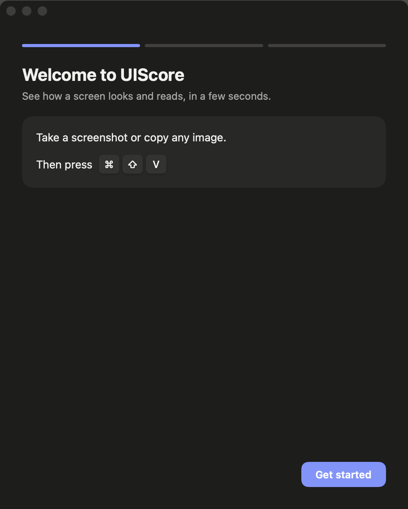

# UIScore

Press a key after a screenshot and get a UI design score.

UIScore is a small Mac menu-bar app. Take a screenshot or copy any image, press **Command + Shift + V**, and a few seconds later you see how the screen looks and reads.



## What it scores

| Group | Meters |
| --- | --- |
| Visual | Contrast, Grouping, Balance, Hierarchy |
| Visual + Copy | Familiarity, Ease, Clarity, Trust |
| Copy | Reading grade, 1 to 12 |
| Feeling | Valence, Intensity |

All meters roll up into one **Score** from 0 to 100.

## Requirements
- macOS 13 or newer.
- A [TypeSafe Jev](https://console.typesafe.ai/keys) key.
- An [Anthropic Claude API](https://console.anthropic.com/settings/keys) key.

Screenshots you score are sent to Anthropic and TypeSafe for analysis. Your keys stay in the Mac Keychain.

## Install
Download **UIScore.zip** from the [latest release](https://github.com/itsdimachka/uiscore/releases/latest), unzip it, and drag **UIScore** into Applications. The first time, macOS asks you to confirm opening it; the steps are in [docs/INSTALL.md](docs/INSTALL.md).

Or paste this into Terminal. It downloads, unzips, installs and opens the app, and skips the Gatekeeper warning:

```sh
curl -L -o ~/Downloads/UIScore.zip https://github.com/itsdimachka/uiscore/releases/latest/download/UIScore.zip && unzip -o ~/Downloads/UIScore.zip -d ~/Downloads && rm -rf /Applications/UIScore.app && mv ~/Downloads/UIScore.app /Applications/ && open /Applications/UIScore.app
```

## Use
1. Take a screenshot, or copy any image.
2. Press **Command + Shift + V**. UIScore scores the newest of the two.
3. Press **esc** to close the card.

Change the shortcut in Settings, from the menu-bar icon.

## Build from source
Needs Xcode.

```sh
swift build
swift test
scripts/make-app.sh   # builds dist/UIScore.app and dist/UIScore.zip
```

Command line: `swift run screencheck-cli shot.png` with `ANTHROPIC_API_KEY` and `JEV_API_KEY` set.

## How scoring works
Each meter is a set of yes/no checks drawn from design research. UIScore detects the page type first (for example SaaS app, store, landing page) so checks that do not apply are skipped. Code measures such as contrast ratios, spacing and text size run locally on the image. Ease also checks that a screen uses at most two typefaces and one or two accent colours (NN/g, Pairing Typefaces and Using Color to Enhance Your Design). Text size is measured from the text's real height by letter shape, so small navigation text is no longer read as too small.

### 0.3.3
- Only clicks in other apps close the card. This fixes the card closing on its own.
- Hierarchy counts repeated same-style titles as one level.
- Grouping is judged on closeness, similarity, shared background and meaning. Alignment is a minor cue.
- Contrast has seven checks (colour, size, weight, spacing) and always explains itself.
- Ease uses relative text sizes and line length, never absolute px. Product demo text does not count as reading.
- Trust counts customer logos and product demonstration.
- Cookie banners and chat bubbles are ignored for layout.
- Comments only name real, visible elements.
- The designer judge follows one set of design principles and standards: Gestalt grouping, visual hierarchy and saliency, contrast, processing fluency, prototypicality and credibility, plus craft standards from Impeccable, UI Craft and Anthropic's design plugin. Each meter's reason is its own.
- The headline-clarity check passes product-demonstrating homepages.
- The footer check applies only when a footer is visible.

Validation on 52 public sites: praised-versus-poor AUC 0.983 (praised mean 91.5, poor 67.2).

### 0.3.2
- Dark screens are judged on their palette, not on how dark they are.
- Grouping checks alignment within each group.
- Forms get no advice about the fold.
- Fix lines come only from vetted checklist advice.
- Reasons match the score.
- The designer rating is the mean of 5 votes.
- History shows a new run at once.
- Tooltips sit on top.
- Clicking outside closes the card.
- The image viewer is a floating window.
- Undo lasts 3 seconds.

### 0.3.0 and 0.3.1: designer ratings
One Claude Sonnet call, asked as a senior product designer, rates all eight meters from 1 to 9 with the measured facts as evidence. Five calls run in parallel and the median per meter is used (the mean from 0.3.2) (three in 0.3.0, five in 0.3.1 to reduce run-to-run wobble). Each meter blends that rating with its checklist score. The designer share per meter, chosen on the gold calibrate half and 40 LabintheWild sites only:

| Meter | Designer share |
| --- | --- |
| Contrast | 0 |
| Grouping | 0.75 |
| Balance | 1 |
| Hierarchy | 0.5 |
| Familiarity | 0.5 |
| Ease | 1 |
| Clarity | 0.75 |
| Trust | 0 |

If fewer than two votes are valid, the checklist score is used alone. Results are cached per image.

On the gold test half (unseen pages), praised-versus-poor AUC rose from 0.53 to 0.83 (praised mean 78.9, poor 63.7). Score tracks human appeal ratings on 60 sites at ρ ≈ 0.47 (95% interval 0.22 to 0.69), held-out 20 at 0.38 (interval -0.12 to 0.76), from Reinecke & Gajos, "Quantifying Visual Preferences Around the World" (2014).

### 0.2.2
Spacing, icon and consistency detectors exist in code but are not scored: none separated praised from poor pages on the calibrate half.

## License
[MIT](LICENSE)
