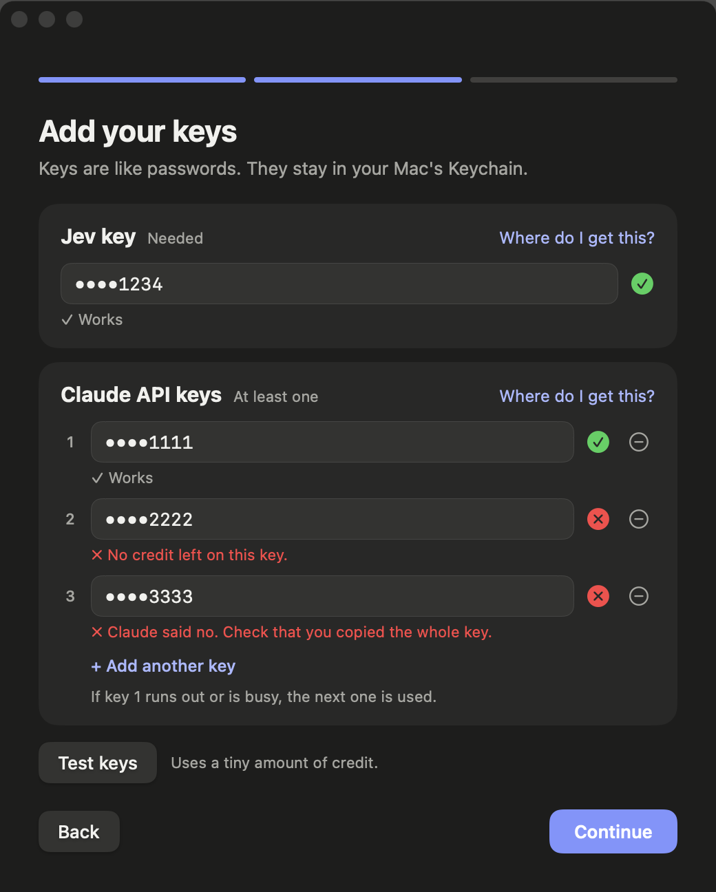
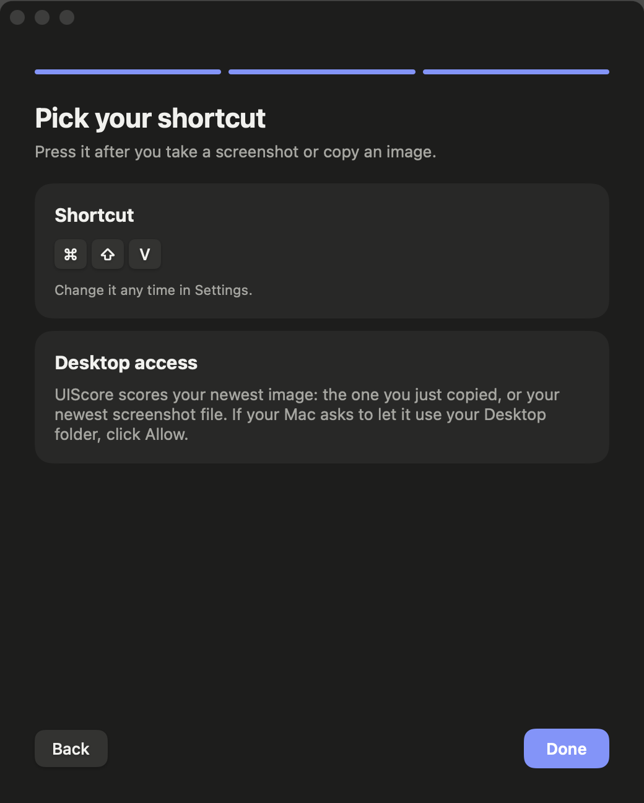

# Install UIScore (Mac)

UIScore looks at a screenshot and gives you a design score. It takes about five minutes to set up.

## What you need
- A Mac with macOS 13 or newer.
- Two keys (like passwords): a TypeSafe Jev key and an Anthropic Claude API key. Step 5 shows where to get them.
- Screenshots you score are sent to Anthropic and TypeSafe. Keys stay in your Mac Keychain.

## Terminal shortcut
Paste this into Terminal to download, install and open UIScore in one go. This route skips the Gatekeeper warning in step 3.

```sh
curl -L -o ~/Downloads/UIScore.zip https://github.com/itsdimabro/uiscore/releases/latest/download/UIScore.zip && unzip -o ~/Downloads/UIScore.zip -d ~/Downloads && rm -rf /Applications/UIScore.app && mv ~/Downloads/UIScore.app /Applications/ && open /Applications/UIScore.app
```

## 1. Unzip
Download **UIScore.zip** from the [latest release](https://github.com/itsdimabro/uiscore/releases/latest). Double-click it in your Downloads folder. **UIScore** appears.

## 2. Move it to Applications
Open **Finder**. Drag **UIScore** onto the **Applications** folder in the left side bar.

## 3. Open it the first time
1. Double-click **UIScore** in Applications.
2. Your Mac says it cannot check the app for bad software. This is normal. The app is not sold in the App Store. Click **Done** (not "Move to Bin").
3. Open **System Settings**, then **Privacy & Security**.
4. Scroll down. You will see: "UIScore was blocked". Click **Open Anyway**.
5. Type your Mac password or use Touch ID. Click **Open Anyway** again.

You only do this once.

## 4. Say hello
A small window opens.


It tells you the two moves you will use: take a screenshot or copy any image, then press **Command + Shift + V**. Click **Get started**.

## 5. Add your keys


- **Jev key**: click **Where do I get this?**, make an account, and copy the key.
- **Claude API key**: click **Where do I get this?**, make a key, and copy it. It starts with `sk-ant-`.
- Want a spare? Click **+ Add another key**. If the first one runs out of credit, UIScore uses the next one.
- Click **Test keys**. A green tick means it works. A red cross tells you what is wrong, in plain words.
- Click **Continue**.

Keys are kept in your Mac's Keychain. They are never shown in full.

## 6. Pick your shortcut


The shortcut is **Command + Shift + V**. To change it, click it and press new keys. Click **Done**.

## 7. Try it
1. Take a screenshot: press **Cmd + Shift + 4** and drag a box around anything on your screen. Or copy any image (for example right-click, then **Copy Image**, in a browser).
2. Press **Command + Shift + V**.
3. The first time, your Mac asks if UIScore can use your **Desktop** folder. Click **Allow**. Screenshots are saved there.
4. After a few seconds, your scores appear. Press **esc** to close.

## If something goes wrong
- **"Your Claude keys stopped working."** Open the menu-bar icon, then **Settings**, then **Edit keys**. Click **Test keys**.
- **Nothing happens when I press the shortcut.** Take a screenshot or copy an image first, then press the shortcut.
- **The window to add keys keeps coming back.** One of the two keys is missing. Add both.
